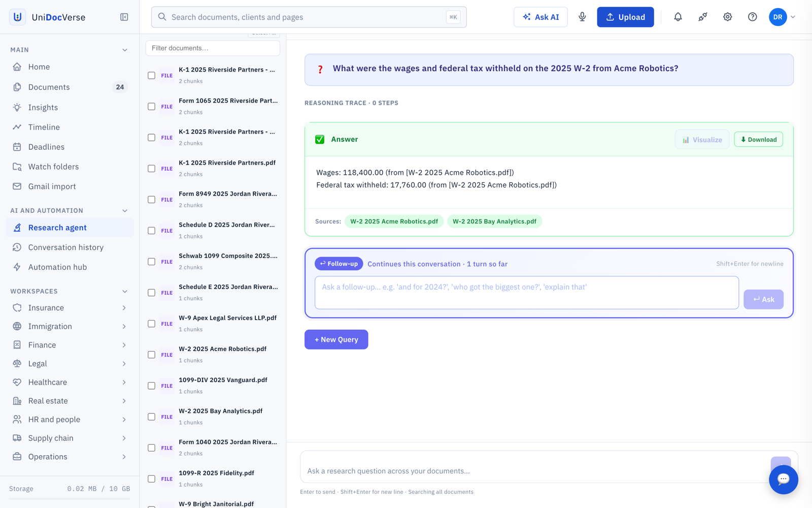
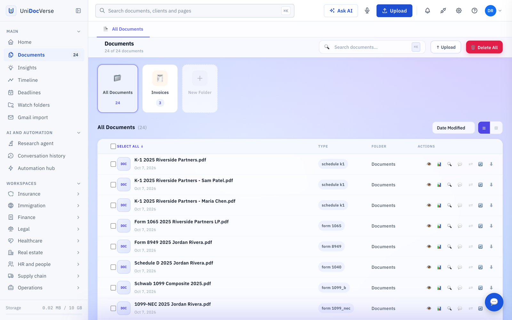
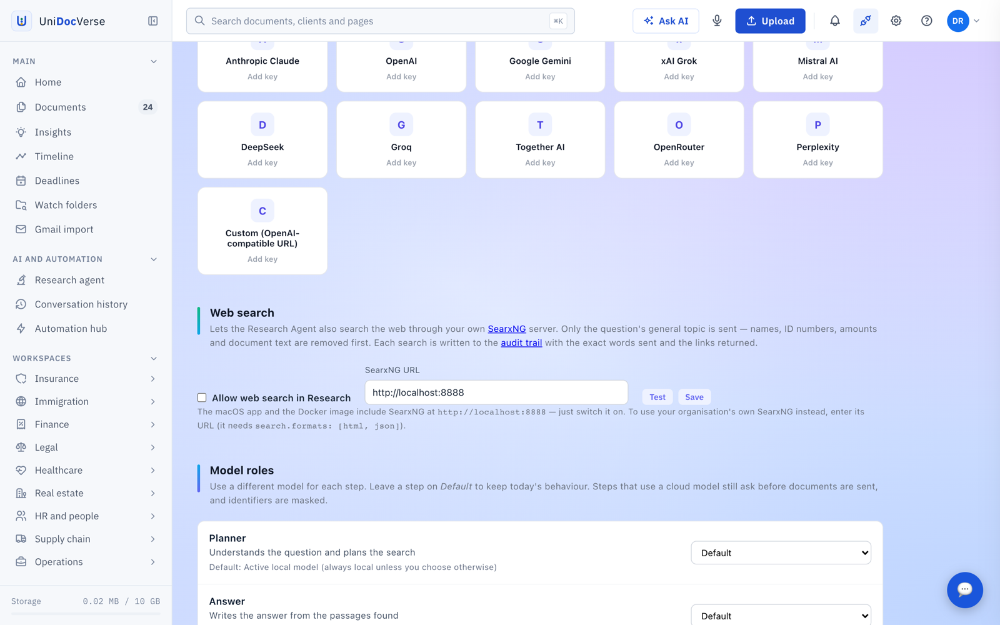
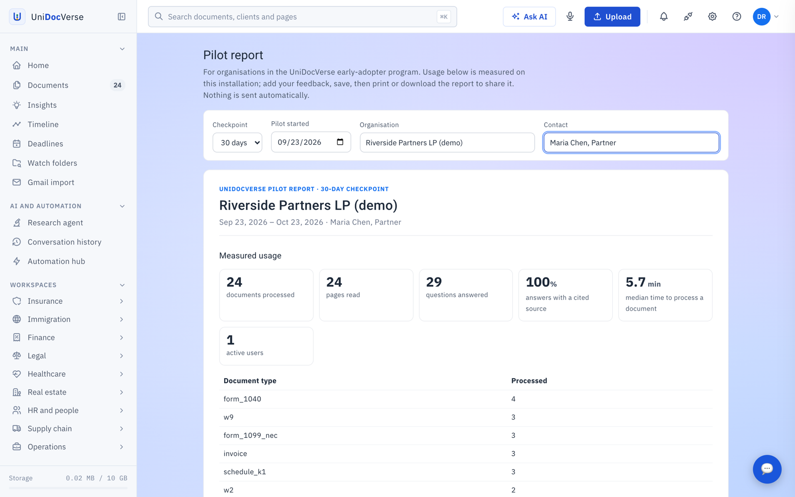
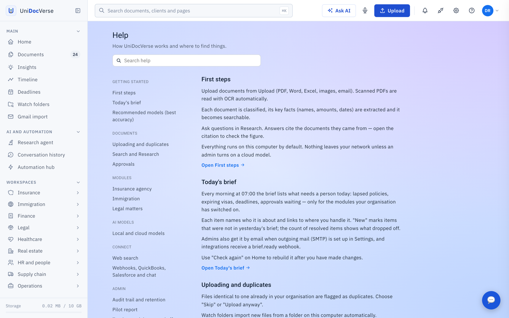

<p align="center">
  
</p>

<h1 align="center">UniDocVerse 📄</h1>

<p align="center">
  <strong>Private, on-premises document intelligence.</strong><br/>
  Upload tax forms, IDs, notices, statements, contracts and reports — then ask questions and get answers
  with the exact page and file they came from. Runs on your own computer or server; your documents stay with you.
</p>

<p align="center">
  <a href="https://unidocverse.com">Website</a> ·
  <a href="#installation">Install</a> ·
  <a href="#troubleshooting">Troubleshooting</a> ·
  <a href="https://hub.docker.com/r/bommavj/unidocverse">Docker Hub</a>
</p>

<p align="center">
  
  
  
  
  
</p>

---

## ✨ Features

- **Ask your documents anything.** Questions are answered from your files, with a citation (file and page) for every fact.
  If the documents don't contain the answer, it says so instead of guessing.
- **Reads every page properly.** Each page is stored on its own with its real page number. Digital PDFs use the text layer;
  scans and phone photos (including iPhone HEIC) are read with **PaddleOCR**, with noise from photos and barcodes filtered out.
- **Forms box by box.** W-2, 1099, 1040, K-1, W-9, passports, USCIS notices, pay stubs, mortgage and property-tax bills are
  read with a local vision model, and every value is checked against the page before it is stored.
- **Charts and tables.** Values drawn in chart images are read and checked; questions that name "Table 1", "Chart 2" or
  "page 47" go straight to that page.
- **Accurate search.** Keyword + vector search (Postgres full-text and pgvector HNSW), a cross-encoder reranker
  (`bge-reranker-v2-m3`), neighbouring passages, multi-part questions split into parts, and dates/years that pick the
  right look-alike document ("my 2024 W-2", "the Jan 9 pay stub").
- **Any model, per step.** Use any Ollama model, a cloud model with your own key (Anthropic, OpenAI, Gemini, xAI,
  Mistral, DeepSeek, Groq, Together, OpenRouter, Perplexity) or any OpenAI-compatible server — and choose a different
  model for planning, answering, extraction and vision (**Model roles**).
- **Data protection for cloud models.** Asks before documents leave your machine, masks identifiers (SSNs, account
  numbers, A-numbers…), never-send document types, monthly budget, and a log of every cloud call.
- **Built for teams.** Organisations, roles, append-only audit trail with retention settings, approvals, duplicate
  detection, a morning brief of what needs attention, and industry modules (insurance, immigration, legal, finance, HR…)
  you can switch on or off.
- **Web search, privately.** A built-in [SearxNG](https://docs.searxng.org) lets Research also search the web. Only the
  question's general topic is sent (names, ID numbers, amounts and document text are removed), and every search is in
  the audit trail. Off until an admin switches it on in **Integrations → Web search**.
- **Connects to your systems.** Signed webhooks, QuickBooks (bills after approval), Salesforce, and MCP for AI assistants.

## Installation

There are two ways to run UniDocVerse: **Docker** (recommended — Windows, Mac and Linux) or the **macOS app**.

### Getting Started with Docker (Recommended)

UniDocVerse **Lite** has no language model inside the image: answers come from [Ollama](https://ollama.com) on your
computer (fast — it uses your GPU / Apple Metal) or from a cloud model you add in **Integrations**. Search, reranking and
scan reading are included.

1. Install a Docker engine: Docker Desktop, or the free [Rancher Desktop](https://rancherdesktop.io) /
   [Podman Desktop](https://podman-desktop.io) (free for any organisation, including government).
2. Install [Ollama](https://ollama.com/download) and pull the models (see [Prerequisites](#prerequisites)):

   ```bash
   ollama pull mistral:7b
   ollama pull gemma4
   ```

3. Run UniDocVerse:

   ```bash
   docker run -d -p 7979:7979 --add-host=host.docker.internal:host-gateway \
     --name unidocverse-app \
     -v unidocverse_pgdata:/var/lib/postgresql/data \
     -v unidocverse_storage:/app/storage \
     --restart always bommavj/unidocverse:lite
   ```

4. Open **http://localhost:7979** and sign in.

**Note:** the `-v` flags keep your database and uploaded files in Docker volumes, so they survive upgrades and restarts.
The image works on Intel/AMD and Apple Silicon (`linux/amd64` and `linux/arm64`).

### macOS app

Download the notarized installer for Apple Silicon (M1 or later) from **[unidocverse.com](https://unidocverse.com)**.
It includes everything — database, search models and a small built-in answer model — so it works offline after install.

### Starter (smallest download)

A ~0.8 GB macOS build published on [GitHub Releases](https://github.com/bommavj/unidocverse/releases); it
downloads its search model on first launch. See [docs/STARTER_EDITION.md](docs/STARTER_EDITION.md).

### Building from source

```bash
git clone https://github.com/bommavj/unidocverse.git
cd unidocverse
docker build -f Dockerfile.lite -t unidocverse:lite .
```

The backend (`unidocverse-service`, FastAPI + Postgres/pgvector) and the web app (`unidocverse-dashboard`, Angular) are
separate repositories: [bommavj/unidocverse-service](https://github.com/bommavj/unidocverse-service) and
[bommavj/unidocverse-dashboard](https://github.com/bommavj/unidocverse-dashboard).

## Prerequisites

| | Minimum | For the most accurate answers |
|---|---|---|
| **Memory** | 16 GB | 32 GB if you read forms and charts |
| **Answer model** | `ollama pull mistral:7b`, or a cloud model in Integrations | A cloud model or a larger local model for long multi-part table questions |
| **Forms & charts** | — | `ollama pull gemma4` (~10 GB). Without it, forms and charts are read as plain text and chart values may be unavailable — answers say so instead of guessing |
| **Disk** | ~10 GB for the image | Plus room for your documents and models |

Installed a model after uploading documents? Reprocess them (**Documents → 🔄**) so they're read again.

## Supported file types

**Documents:** PDF, DOC/DOCX, ODT, RTF, TXT, HTML ·
**Spreadsheets:** XLS/XLSX, CSV, TSV, ODS, Parquet, JSON ·
**Presentations:** PPT/PPTX, ODP ·
**Images (OCR):** JPG, PNG, WebP, HEIC/HEIF, TIFF, BMP ·
**Email:** EML, MSG, MBOX ·
**Data:** JSONL, XML, YAML

## Screenshots

All screenshots use the built-in demo organisation (fictional people and companies).

**Research agent** — answers cite the file each figure came from



**Documents** — every upload classified by type (W-2, 1099, K-1, 1040, W-9…)



**Integrations** — private web search (SearxNG), cloud model keys and a model per step



**Pilot report** — usage measured on your installation, for 30/60/90-day reviews



**Help** — built into the app



## Troubleshooting

#### Answers don't work / "Choose how UniDocVerse answers questions"
Lite has no model inside. Install Ollama and run `ollama pull mistral:7b`, or add a cloud model in
**Integrations → Cloud models**, then press **Check again** on the Home page.

#### Ollama connection errors (Docker)
- Make sure Ollama is running on the host: `curl http://localhost:11434/api/tags`.
- On Linux, keep `--add-host=host.docker.internal:host-gateway` in the `docker run` command.
- If Ollama listens only on 127.0.0.1 and the container still can't reach it, start it with `OLLAMA_HOST=0.0.0.0 ollama serve`.

#### Local OpenAI-compatible servers (llama.cpp, LM Studio, vLLM)
Add them in **Integrations → Cloud models → Custom** with the server's URL (for example `http://host.docker.internal:8080/v1`).

#### The machine slows down or freezes
A vision model and an answer model loaded together can exceed 16 GB. Let Ollama keep one model at a time
(`OLLAMA_MAX_LOADED_MODELS=1`) and avoid heavy jobs while uploading large reports.

#### "No space left on device" in Docker
Docker's virtual disk is full. Remove unused images (`docker image prune`) or raise the disk limit in Docker Desktop →
Settings → Resources.

#### A chart question says its values haven't been read
Install the vision model (`ollama pull gemma4`) and reprocess that document.

## Using the API

The backend is a REST API on port 7979 (OpenAPI docs at `http://localhost:7979/docs`). Create an API token in
**Settings** and send it as `Authorization: Bearer <token>`. An MCP server lets assistants such as Claude Desktop search
and read your documents with your permission (**Integrations → MCP Clients**).

## Upcoming features

- [ ] Native Windows installer
- [ ] Review queue for low-confidence form values
- [ ] Form templates with built-in math checks (W-2, 1099, 1040)
- [ ] Answering table questions from structured rows
- [ ] More integrations (Xero, HubSpot, Clio)

## Contribution

Issues and pull requests are welcome. Please open an issue first for larger changes so we can agree on the approach,
and don't include real personal documents in issues or test files.

## Help and Support

- Website and docs: [unidocverse.com](https://unidocverse.com)
- Bugs and feature requests: [GitHub Issues](https://github.com/bommavj/unidocverse/issues)
- Inside the app: **Help** (top bar) and **Report issue**

## License

UniDocVerse is licensed under the [Apache License 2.0](LICENSE).
